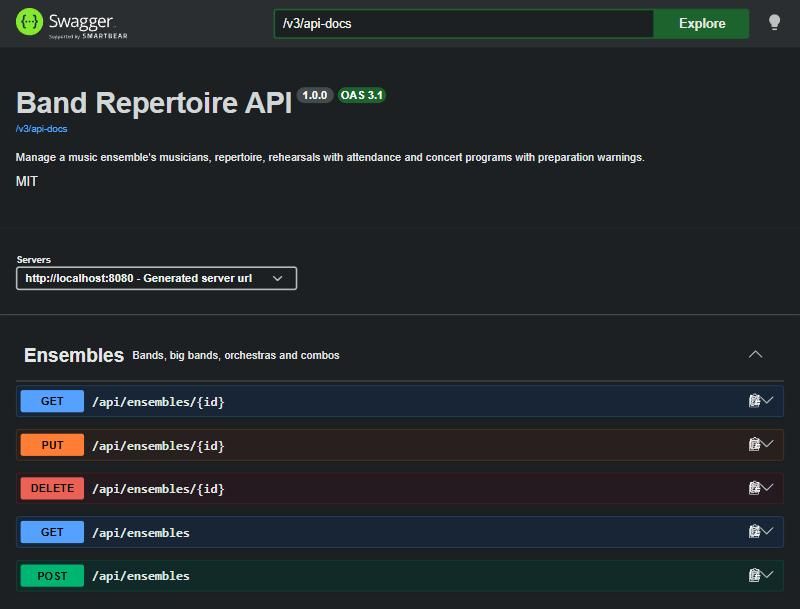
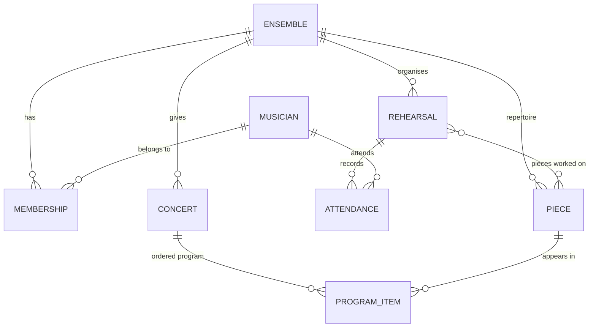

# Band Repertoire API

[](https://github.com/IvanStgAlej/band-repertoire-api/actions/workflows/ci.yml)

A REST API for bands, big bands and orchestras: it manages musicians, repertoire, rehearsals with attendance
and concert programs, and **warns you which pieces are not ready** before a concert.

Built with **Java 21 and Spring Boot 4**, with PostgreSQL, Flyway, OpenAPI, Docker Compose and GitHub Actions.



## Why

I have played the saxophone in three ensembles for 13 years. Every season the same questions come up: *which
pieces have we not touched for weeks?*, *is the concert program ready?*, *who keeps missing rehearsals?*
This API answers them, and it is a small but complete example of how I build a backend.

## Features

- **CRUD** for ensembles, musicians, memberships, repertoire, rehearsals and concerts, with pagination.
- **Concert summary:** total duration, number of pieces and average difficulty, plus a warning for each piece
  that has not been rehearsed in the 3 weeks before the concert. A rehearsal on the concert day itself does
  not count: concerts have a date but no time, and a warm-up on the day is not preparation.
- **Forgotten repertoire:** pieces not rehearsed in the last N weeks, never-rehearsed pieces first.
- **Attendance report:** each member's attendance rate over a period, lowest first.
- **Repertoire search** by text (title or composer), genre, maximum difficulty and ensemble.
- **Domain rules with clear errors:** a piece cannot appear twice in a program (`409`), a program can only use
  the ensemble's own repertoire (`422`), only members can be marked present (`422`), and deleting a piece that
  is in a program is refused (`409`).
- **Consistent errors:** every error is an RFC 9457 `application/problem+json` document. Validation errors list
  the invalid fields.

## Tech stack

| Area | Technology |
|---|---|
| Language | Java 21 |
| Framework | Spring Boot 4.1 (Web MVC, Data JPA, Validation, Actuator) |
| Database | H2 in PostgreSQL mode (development and tests), PostgreSQL 16 (Docker) |
| Migrations | Flyway |
| API docs | springdoc-openapi (Swagger UI) |
| Tests | JUnit 5, MockMvc, Mockito, AssertJ, `@DataJpaTest` |
| Build | Maven Wrapper |
| Delivery | Docker multi-stage build, Docker Compose, GitHub Actions |

## Data model



A musician can play in several ensembles, with a different instrument in each one. That is why `Membership`
is an entity of its own and not a plain many-to-many.

## Run it

**With nothing installed but Java 21.** This uses an in-memory H2 database with demo data:

```bash
./mvnw spring-boot:run
```

**With Docker.** This runs the API and PostgreSQL 16:

```bash
docker compose up --build
```

Then open <http://localhost:8080/swagger-ui.html>.

Both ways load a fictional concert band with 8 musicians, 15 pieces, six rehearsals and an *Autumn Concert*
two weeks from today. The concert summary therefore shows real warnings from the first run.

The demo dates are relative to the day the database was created. H2 starts fresh on every run, but the Docker
volume keeps PostgreSQL's data, so after a few days the concert is in the past. Reset the demo data with:

```bash
docker compose down -v
```

> The PostgreSQL credentials in `docker-compose.yml` are for local development only.

## API

| Resource | Endpoints |
|---|---|
| Ensembles | `GET/POST /api/ensembles` · `GET/PUT/DELETE /api/ensembles/{id}` |
| Musicians | `GET/POST /api/musicians` · `GET/PUT/DELETE /api/musicians/{id}` |
| Members | `GET/POST /api/ensembles/{id}/members` · `DELETE /api/ensembles/{id}/members/{musicianId}` |
| Repertoire | `GET/POST /api/ensembles/{id}/pieces` · `GET/PUT/DELETE /api/pieces/{id}` · `GET /api/pieces?q=&genre=&maxDifficulty=&ensembleId=` |
| Rehearsals | `GET/POST /api/ensembles/{id}/rehearsals` · `GET /api/rehearsals/{id}` · `PUT /api/rehearsals/{id}/attendance` |
| Concerts | `GET/POST /api/ensembles/{id}/concerts` · `GET /api/concerts/{id}` · `PUT /api/concerts/{id}/program` |
| Insights | `GET /api/concerts/{id}/summary` · `GET /api/ensembles/{id}/pieces/stale?weeks=4` · `GET /api/ensembles/{id}/attendance?from=&to=` |

### Examples

Is the concert ready?

```bash
curl http://localhost:8080/api/concerts/1/summary
```

```jsonc
// trimmed: the demo concert has two warnings
{
  "concertId": 1,
  "title": "Autumn Concert",
  "pieceCount": 6,
  "totalDurationSeconds": 2340,
  "totalDuration": "39:00",
  "averageDifficulty": 3.5,
  "warnings": [
    {
      "pieceId": 3,
      "title": "Amparito Roca",
      "lastRehearsedAt": "2026-10-03T19:30:00",
      "message": "Last rehearsed on 2026-10-03, more than 3 weeks before the concert"
    }
  ]
}
```

What have we forgotten?

```bash
curl "http://localhost:8080/api/ensembles/1/pieces/stale?weeks=4"
```

Who is missing rehearsals?

```bash
curl "http://localhost:8080/api/ensembles/1/attendance?from=2026-09-01&to=2026-10-31"
```

Set the program, in order:

```bash
curl -X PUT http://localhost:8080/api/concerts/1/program \
  -H "Content-Type: application/json" \
  -d '{"pieceIds": [1, 2, 4, 8]}'
```

An error looks like this:

```json
{
  "type": "about:blank",
  "title": "Conflict",
  "status": 409,
  "detail": "Piece 2 appears more than once in the program",
  "instance": "/api/concerts/1/program"
}
```

## Design decisions

- **Package by feature** (`ensemble`, `piece`, `concert`, ...) instead of by layer. Everything about one concept
  lives together, and each package has its own entity, repository, service, controller and DTOs.
- **DTOs are Java records.** Controllers never return JPA entities, so the database model can change without
  breaking clients.
- **One error format.** A single `@RestControllerAdvice` turns domain exceptions into `ProblemDetail`
  responses (Spring's built-in RFC 9457 support). Spring MVC errors such as malformed JSON, a wrong type or an
  unknown sort property get the same format, so a client never sees an HTML error page or a stack trace.
- **Flyway owns the schema.** Hibernate only validates it (`ddl-auto=validate`), so every schema change is a
  versioned migration.
- **H2 for development, PostgreSQL in Docker.** The project starts with zero setup. CI also boots the Docker
  Compose stack and calls the API against a real PostgreSQL.
- **Demo data relative to today.** The demo migration uses `CURRENT_DATE`, so the reports show meaningful
  results whenever you run it. The migration lives in its own Flyway location that tests do not load.
- **Rules live in services and the database backs them up.** Duplicates and cross-ensemble references are
  checked in the service layer with a clear message. Unique and foreign keys guarantee the same rules at the
  database level.
- **Replacing a program flushes before inserting.** Hibernate runs inserts before deletes. Re-adding a piece
  that was already in the program would break the unique keys, so the service deletes the old items and
  flushes first.
- **Time comes from an injected `Clock`.** Reports that depend on "today" are tested with a fixed date.

## Testing

```bash
./mvnw verify
```

About 100 tests:

- **HTTP-level tests** (MockMvc on the full application and a real H2 database) cover every endpoint, the
  status codes `200/201/204/400/404/409/422` and the error format. Most are rolled back after each test; a few
  commit every request, so program replacement and ensemble deletion are also checked against real commits and
  `ON DELETE CASCADE`.
- **Unit tests** (Mockito) cover the concert summary and attendance report logic, with a fixed clock.
- **`@DataJpaTest` tests** run the custom JPQL queries against the Flyway schema: never-rehearsed pieces,
  future rehearsals, other ensembles.
- **A demo data test** checks that the seed data loads and that the reports find what they should.

GitHub Actions runs the whole suite on every push. It then builds the Docker image and smoke-tests the
endpoints against PostgreSQL.

## Roadmap

- Android client in Kotlin and Jetpack Compose: repertoire, the next concert and taking attendance.
- Spring Security with JWT and roles (conductor / musician).
- Testcontainers for integration tests on PostgreSQL.
- Public deployment with a live demo link.

## License

MIT
